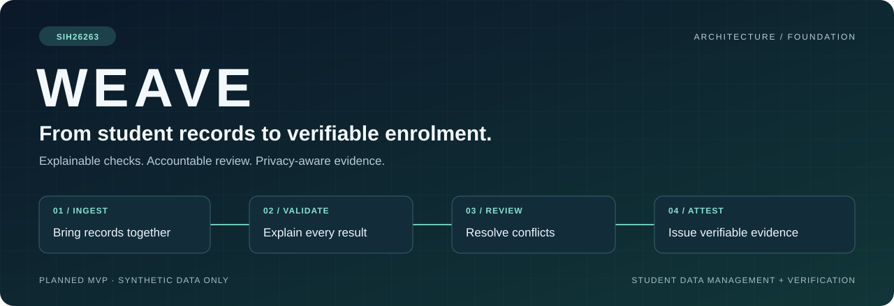
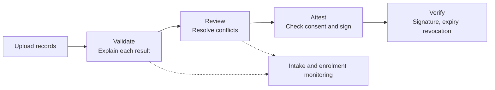
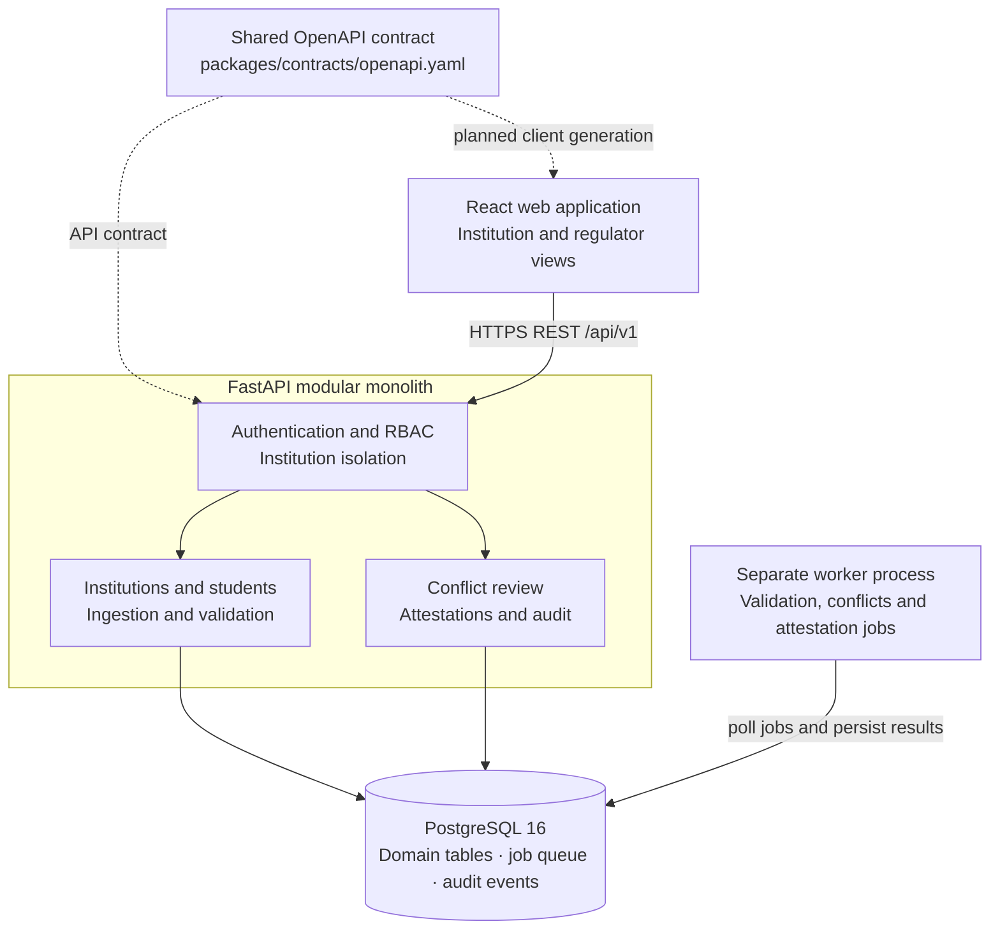

<p align="center">
  
</p>

<p align="center">
  
  
  
  
  <a href="LICENSE"></a>
</p>

<p align="center">
  <a href="#in-plain-words">Overview</a> ·
  <a href="#what-makes-weave-different">USP</a> ·
  <a href="#planned-capabilities">Features</a> ·
  <a href="#architecture">Architecture</a> ·
  <a href="#getting-started">Getting started</a> ·
  <a href="#documentation">Documentation</a>
</p>

---

## In plain words

**WEAVE is a planned APAAR ID-based student data management and verification platform for AICTE-approved institutions**, developed for problem statement **SIH26263**. It brings student record ingestion, explainable checks, conflict review and verifiable enrolment attestations into one controlled workflow.

An institution needs more than a place to upload records. It needs to understand which records are inconsistent, which enrolments need review, how enrolment compares with approved intake, and what evidence supports an issued attestation. WEAVE's design connects those decisions with institution-scoped access and an auditable history.

> [!IMPORTANT]
> **Current stage: architecture and repository foundation.** This repository contains design documents, workspace placeholders, an environment template and an initial OpenAPI contract. Application code, database migrations, workers, deployment files and tests are not implemented yet. Features and diagrams below describe the intended MVP.

### The intended workflow

1. An institution operator uploads a CSV of synthetic student records.
2. A background worker normalizes the records and applies deterministic validation rules, recording the reason for each result.
3. Duplicate or cross-institution conflicts enter a human review queue. Institution and regulator views support intake-versus-enrolment monitoring.
4. An authorized user issues a consent-aware, platform-signed enrolment attestation. QR verification checks its signature, expiry and revocation status.
5. Critical actions leave a tamper-evident audit trail for review.



## What makes WEAVE different

**WEAVE's intended differentiator is the connection between record quality, accountable review and verifiable evidence.** Its design carries a student record through a process whose checks and decisions can be explained.

| Design commitment | Practical value |
| --- | --- |
| **Explainable validation** | Deterministic rules produce outcomes and reasons that operators can inspect. |
| **Human review for conflicts** | Duplicate and cross-institution cases have a review workflow and decision history. |
| **Intake visibility** | Approved intake and enrolment can be compared within institution and regulator views. |
| **Consent-aware attestations** | Issuance, signature verification, expiry and revocation form one attestation lifecycle. |
| **Protected identifiers** | Masked display values and hashes support display and matching while restricting identifier exposure. |
| **Traceable decisions** | Tamper-evident audit events connect critical actions to actors and records. |

These are design commitments; implementation and verification remain on the [delivery roadmap](docs/07-delivery-plan.md).

## Planned capabilities

| Capability | Intended behaviour | Primary users |
| --- | --- | --- |
| Institution and regulator dashboards | Present institution-scoped records and cross-institution oversight views according to permissions. | Institution operators, regulator analysts |
| CSV ingestion and batch processing | Upload, normalize and process student records through background jobs. | Institution operators |
| Validation engine | Apply deterministic, explainable rules and retain per-record results. | Operators, reviewers |
| Conflict review | Detect duplicate and cross-institution conflicts and record human resolutions. | Institution reviewers |
| Intake monitoring | Compare approved intake with enrolment and expose trends. | Institutions, regulator analysts |
| Attestation lifecycle | Check consent, issue Ed25519-signed attestations, and support QR verification, expiry and revocation. | Institutions, attestation verifiers |
| Audit history | Retain tamper-evident events for critical actions and review their rationale. | Security and audit reviewers |

The [feature analysis](docs/01-analysis-and-features.md) defines the MVP and persona mapping. An optional, read-only admin AI copilot is **proposed and disabled by default**; it is outside the core MVP delivery path.

## Architecture

WEAVE adopts a **modular monolith**: a single backend with explicit internal module boundaries, a separate React frontend and a separate worker process. PostgreSQL holds domain records, audit events and the background job queue. This keeps the MVP deployable without introducing a separate message broker or microservice fleet.



The planned backend modules are `auth`, `institutions`, `students`, `ingestion`, `validation`, `conflicts`, `attestations` and `audit`. Authorization and deterministic decisions belong in backend services. The frontend provides routing, forms, query state, charts and accessible interaction patterns.

See the [system architecture](docs/02-system-architecture.md), [database design](docs/03-database-schema.md) and [decision register](DECISION.md) for the underlying boundaries and constraints.

### Selected technology stack

| Layer | Accepted direction |
| --- | --- |
| Web application | React 18, TypeScript, Vite, React Router |
| Data and forms | TanStack Query, React Hook Form, Zod |
| Interface and charts | Tailwind CSS, accessible Radix-based UI, Recharts |
| API | Python 3.12, FastAPI, Uvicorn, Pydantic v2 |
| Persistence | PostgreSQL 16, SQLAlchemy 2.0, Alembic |
| Background processing | PostgreSQL-backed queue with a separate worker process |
| Contract | OpenAPI 3.1, REST JSON under `/api/v1` |
| Development mocks | MSW, development only, explicitly labelled synthetic |
| Deployment | Docker Compose locally; a simple cloud demo deployment is planned |

These are accepted stack decisions, not installed application dependencies. [DECISION.md](DECISION.md) is the architectural source of truth.

## Trust, privacy and verification

The [rulebook](RULEBOOK.md) makes the following requirements mandatory for implementation:

- **Synthetic student data only** in development, demos, fixtures and tests; no Aadhaar collection or unnecessary personal data.
- **Protected APAAR references:** masked displays by default; no full identifiers in responses, logs, exports or QR payloads.
- **Backend-enforced access:** role-based authorization and institution isolation on every relevant query.
- **Verifiable attestations:** Ed25519 signatures, issuance and expiry timestamps, revocation checks, and signing keys kept outside Git.
- **Tamper-evident history:** chained audit hashes for critical actions, with request IDs for traceability.
- **Deterministic decisions:** LLMs cannot decide validation, authorization or signature verification. Any future copilot must remain read-only, permission-scoped and advisory.

> [!NOTE]
> **A WEAVE attestation is platform-issued enrolment evidence.** The project does not currently perform official APAAR identity verification or connect to government services. Such integration requires legal and technical authorization; synthetic connectors must be clearly labelled `SYNTHETIC`.

The detailed requirements are in [Security and Privacy](docs/05-security-and-privacy.md).

## Getting started

You can clone and explore the foundation today. **There is no runnable frontend, API, Docker Compose configuration or test suite yet.**

```bash
git clone https://github.com/Sarthaksulkhlan/WEAVE.git
cd WEAVE
```

Create a local environment file only if one does not already exist:

```powershell
# Windows PowerShell
if (!(Test-Path .env)) { Copy-Item .env.example .env }
```

```bash
# macOS / Linux
test -f .env || cp .env.example .env
```

The [environment template](.env.example) records planned API, database, worker, signing-key and frontend settings. Its placeholders require local configuration when services are implemented. Keep `.env` and signing material uncommitted.

For implementation, the documented prerequisites are **Node.js 20+**, **Python 3.12**, **Docker with Docker Compose**, and **Git**. On Windows, PowerShell or Windows Terminal is suitable; WSL2 with Docker Desktop integration is recommended in the existing setup guidance. VS Code is the recommended editor.

Start by reading [DECISION.md](DECISION.md) and [RULEBOOK.md](RULEBOOK.md), then the [feature analysis](docs/01-analysis-and-features.md) and [system architecture](docs/02-system-architecture.md). Runtime commands will be added alongside the application scaffolds.

## API contract and development workflow

[`packages/contracts/openapi.yaml`](packages/contracts/openapi.yaml) is the shared contract. Version `0.1.0` currently describes only a health-check operation and a common error schema; it does not represent a running service.

The [API specification guidance](docs/04-api-spec.md) outlines the future authentication, institution, batch upload, validation, conflict, attestation and audit endpoints.

1. Create a focused branch from `main`: `feat/web-...` for frontend work or `feat/api-...` for backend work.
2. Update the shared contract before implementing API changes. **Both Sarthak and Satyam must review and approve contract changes.**
3. Keep backend behaviour and the planned generated TypeScript client aligned to the same contract version.
4. Use Alembic for schema changes, add relevant implementation tests, and update documentation when architecture or security behaviour changes.
5. Keep pull requests small and merge only after applicable checks and rulebook requirements are met.

The [testing strategy](docs/06-testing-strategy.md) calls for backend unit and integration tests, migration checks, frontend accessibility and interaction tests, contract drift checks, and end-to-end upload/review/verification coverage. Security testing must cover authorization bypass, tenant isolation and identifier leakage. These checks are planned, not yet configured.

## Roadmap

| Milestone | Scope | Status |
| --- | --- | --- |
| **0 · Foundation** | Architecture, ownership, rulebook, workspace structure and contract scaffold | Current phase; foundation artifacts present |
| **1 · Backend skeleton** | FastAPI bootstrap, auth skeleton, PostgreSQL, initial migration and queue skeleton | Planned |
| **2 · Frontend skeleton** | Vite application, routes, query client, UI shell, session handling and generated API client | Planned |
| **3 · Core MVP** | Upload, validation, conflict review, intake monitoring and attestation lifecycle | Planned |
| **4 · Hardening and demo** | Security checks, synthetic end-to-end demo and deployment rehearsal | Planned |

Track scope in the [delivery plan](docs/07-delivery-plan.md) and [problem statement checklist](docs/PS-CHECKLIST.md).

<details>
<summary><b>Repository layout</b></summary>

```text
apps/
  web/                    Frontend workspace placeholder
  api/                    Backend workspace placeholder
packages/
  contracts/openapi.yaml  Shared OpenAPI contract scaffold
  fixtures/               Planned shared synthetic fixtures
docs/                     Feature, architecture, API and delivery documents
  assets/                 README visual assets
help/                     Planned operator playbooks and onboarding
rules/                    Planned deterministic rule definitions and metadata
data/                     Synthetic local development artifacts only
synthetic/                Planned synthetic data generation assets
infra/                    Planned deployment and infrastructure assets
.env.example              Local configuration template
DECISION.md               Architecture decisions and ownership boundaries
RULEBOOK.md               Mandatory engineering and data-handling practices
LICENSE                   Apache License 2.0
```

</details>

## Documentation

| Document | What it covers |
| --- | --- |
| [Decision register](DECISION.md) | Accepted stack, architecture, ownership and proposed decisions |
| [Engineering rulebook](RULEBOOK.md) | Mandatory data, security, AI, contract and delivery rules |
| [Analysis and features](docs/01-analysis-and-features.md) | Problem, personas, MVP features and exclusions |
| [System architecture](docs/02-system-architecture.md) | Components, data flow and planned module boundaries |
| [Database schema](docs/03-database-schema.md) | Planned tables, tenant keys and identifier storage |
| [API specification](docs/04-api-spec.md) | Endpoint plan, error format and client generation workflow |
| [OpenAPI contract](packages/contracts/openapi.yaml) | Machine-readable contract scaffold |
| [Security and privacy](docs/05-security-and-privacy.md) | Access control, attestation security and audit requirements |
| [Testing strategy](docs/06-testing-strategy.md) | Planned test coverage and CI expectations |
| [Delivery plan](docs/07-delivery-plan.md) | Milestones and working agreement |
| [Problem statement checklist](docs/PS-CHECKLIST.md) | Foundation coverage and pending implementation |

## Team and license

| Owner | Responsibility |
| --- | --- |
| **Sarthak** | Frontend application in `apps/web` |
| **Satyam** | Backend, database, APIs, validation, authentication/security, infrastructure and synthetic data generation |
| **Shared** | OpenAPI contract approval, security model and cross-cutting architecture documentation |

WEAVE is the working project name for **SIH26263**. Licensed under the [Apache License 2.0](LICENSE).
