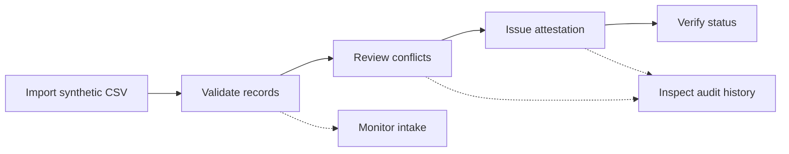
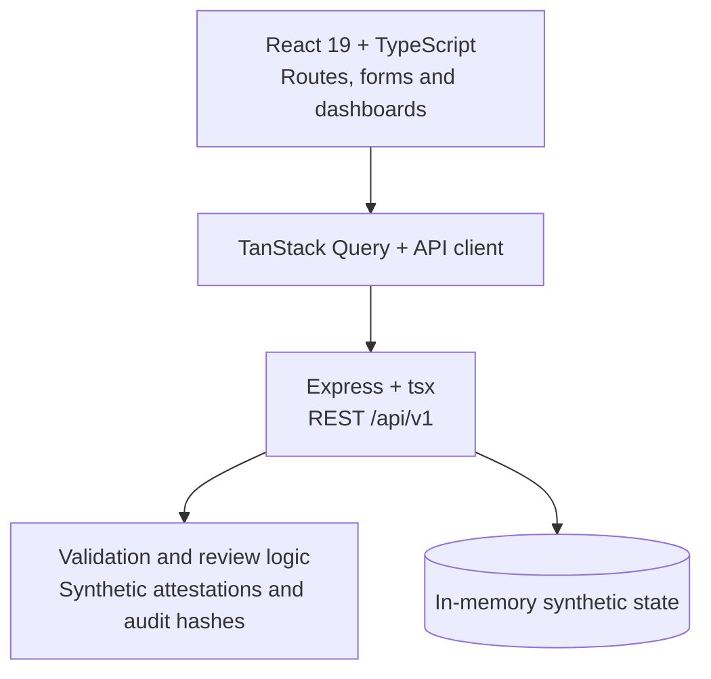
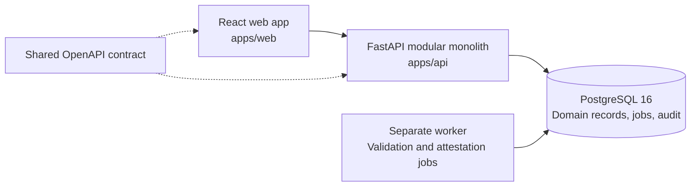

<p align="center">
  
</p>

<p align="center">
  
  
  
  
  <a href="LICENSE"></a>
</p>

<p align="center">
  <b>Explainable checks. Accountable review. Verifiable enrolment.</b><br>
  Student data management and verification for AICTE-approved institutions.
</p>

<p align="center">
  <a href="#why-weave">Why WEAVE</a> ·
  <a href="#run-locally">Run locally</a> ·
  <a href="#explore-the-workflow">Workflow</a> ·
  <a href="#architecture">Architecture</a> ·
  <a href="#documentation">Documentation</a>
</p>

---

## Why WEAVE

A student record can look valid on its own and still conflict with another institution's enrolment, exceed approved intake, or lack the consent needed to issue evidence. Resolving those cases requires the original checks, the review decision and the resulting attestation to stay connected.

**WEAVE connects record ingestion, deterministic validation, human conflict review and enrolment attestations in one workspace.** Built for **SIH26263**, it gives institution operators, reviewers, regulator analysts and auditors a shared workflow with different views of the same records.

> [!IMPORTANT]
> **Current stage: synthetic application prototype.** The repository includes a React interface, an Express demo API and an in-memory validation engine. The accepted FastAPI/PostgreSQL architecture remains the target. Demo authentication and signature simulation are not production security or official APAAR identity verification.

### What makes it different

| Design focus | Practical value |
| --- | --- |
| **Reasons alongside results** | Deterministic checks expose why a record needs attention, so an operator can act on the finding. |
| **Review before resolution** | Duplicate and cross-institution cases enter a human review workflow with a recorded decision. |
| **Intake in context** | Enrolment can be compared with approved programme capacity alongside record quality. |
| **Evidence with a lifecycle** | The demo connects issuance, consent checks, expiry, revocation and public verification. |
| **Traceable actions** | Audit events connect changes to actors, records and outcomes. |
| **Protected identifiers by design** | Masked display values and matching references support the intended privacy model. |

These are product priorities, not a claim of uniqueness or completed production assurance. The [feature analysis](docs/01-analysis-and-features.md) defines the MVP scope.

## Run locally

Use **Node.js 22+**, npm and Git. The current demo does not require PostgreSQL, Python or Docker.

```bash
git clone https://github.com/Sarthaksulkhlan/WEAVE.git
cd WEAVE
npm install
npm run dev
```

Open **http://localhost:3000**. The Express server hosts the API and Vite development middleware on the same port. Visit `/login` and select a synthetic persona; the form supplies demo credentials.

Demo records live in server memory. Restarting the server recreates the seeded state.

<details>
<summary><b>Commands and configuration</b></summary>

| Command | Purpose |
| --- | --- |
| `npm run dev` | Start the demo API and frontend on port 3000. |
| `npm run lint` | Run TypeScript checking with `tsc --noEmit`. |
| `npm test` | Run the validation engine tests using Node's test runner through `tsx`. |
| `npm run build` | Build the frontend into `dist/`. |
| `npm start` | Serve the built frontend and API in production mode on POSIX shells. |

For the equivalent production-mode command in Windows PowerShell, run `npm run build`, then:

```powershell
$env:NODE_ENV = 'production'
npx tsx server.ts
```

The repository includes a `bun.lock`; npm users will generate a local `package-lock.json` on installation.

The [.env.example](.env.example) file lists settings for the target architecture. The current server uses port **3000** and the frontend calls **`/api/v1`** directly; those template values do not configure the current runtime. Optional Gemini endpoints read `GEMINI_API_KEY` from the process environment. Core demo workflows do not need that key. The server does not automatically load `.env` files.

</details>

## Explore the workflow



1. **Choose a persona.** Open the institution or regulator workspace from the demo login.
2. **Import records.** Use the CSV wizard and inspect the batch's validation results before committing records.
3. **Review exceptions.** Open the duplicate queue, inspect a case and record a resolution.
4. **Monitor enrolment.** Compare programme intake and enrolment, then inspect the student directory.
5. **Follow the evidence.** Explore attestation issuance and verification, then inspect the associated audit timeline.

### Workspace capabilities

| Area | Included in the prototype | Entry point |
| --- | --- | --- |
| Dashboard | Institution and regulator views with enrolment summaries | `/app` |
| Student directory | Record browsing and attestation actions | `/app/students` |
| CSV imports | Upload wizard, batch results and commit flow | `/app/imports` |
| Conflict review | Duplicate and cross-institution case review | `/app/duplicates` |
| Intake monitoring | Approved capacity and enrolment comparisons | `/app/intake` |
| Institution directory | Institution and programme views | `/app/institutions`, `/app/programs` |
| Audit timeline | Event history and demo chain verification | `/app/audit` |
| Public verification | Attestation status by opaque token | `/verify/:token` |
| Spatial view | Three.js visual exploration | `/app/topology` |
| Assistant | Advisory interface and optional Gemini endpoints | `/app/assistant` |

The assistant is experimental. [D-011](DECISION.md) still treats an optional, read-only copilot as proposed; the current demo implementation should not be interpreted as approval of a production AI integration.

## Architecture

### Current prototype



The runnable application lives at the repository root. [`server.ts`](server.ts) provides demo endpoints and serves the frontend. [`weaveEngine.ts`](src/lib/weaveEngine.ts) contains validation, CSV parsing, identifier helpers and simulated verification. [`syntheticSeed.ts`](src/lib/syntheticSeed.ts) supplies the demo accounts and records.

| Layer | Current implementation | Accepted target |
| --- | --- | --- |
| Frontend | React 19, TypeScript, Vite, React Router 7 | React 18 stack documented for `apps/web` |
| UI and data | Tailwind CSS 4, TanStack Query, React Hook Form, Zod, Recharts, Three.js | Accessible UI primitives and contract-generated client |
| API | Express 4 running through `tsx` | Python 3.12, FastAPI, Uvicorn, Pydantic v2 |
| Persistence | Process-local synthetic state | PostgreSQL 16, SQLAlchemy 2.0, Alembic |
| Batch processing | Demo processing inside the server | PostgreSQL-backed queue and separate worker |
| Attestations | Deterministic signature simulation | Ed25519 signing with externally managed keys |

### Target system



[DECISION.md](DECISION.md) remains the architectural source of truth. The [system architecture](docs/02-system-architecture.md) describes the target module boundaries; those documents and the [delivery plan](docs/07-delivery-plan.md) still describe the foundation phase and are not an inventory of the current demo.

## Trust and implementation limits

The [rulebook](RULEBOOK.md) requires synthetic data, protected APAAR identifiers, backend authorization, institution isolation, tamper-evident audit history and real Ed25519 attestations. Production implementation must satisfy those requirements.

The current prototype has specific limits:

- **Synthetic access:** login and role selection simulate sessions; they do not establish production authentication or trusted tenant authorization.
- **Simulated signatures:** the engine prefixes a deterministic hash with `ed25519:`. It does not perform Ed25519 cryptographic signing, despite labels used in parts of the demo.
- **Volatile state:** records and audit events reset on restart; there is no durable database or separate worker yet.
- **No government connection:** platform attestations are enrolment evidence concepts, not official APAAR identity verification. Live integration requires authorization.
- **Advisory AI:** validation, authorization and verification decisions must remain deterministic. Optional assistant output must not become decision authority.

Use synthetic records only. Do not enter real student identifiers or deploy this demo as a production verification service.

## Development roadmap

| Next step | Outcome |
| --- | --- |
| Reconcile prototype and accepted decisions | Confirm runtime versions, workspace layout and API contract coverage. |
| Build the persistent backend | FastAPI modules, PostgreSQL schema, Alembic migrations and a job worker. |
| Enforce trust boundaries | Real authentication, backend RBAC and institution isolation. |
| Implement attestation security | Real Ed25519 keys, consent enforcement, expiry and revocation. |
| Verify the complete workflow | Integration, accessibility, contract and end-to-end coverage. |
| Prepare deployment | Docker Compose, synthetic demo rehearsal and documented operations. |

The existing [engine tests](src/lib/weaveEngine.test.ts) cover identifier helpers, validation, CSV parsing, simulated attestation verification, audit hashes and API error shape. They do not establish production security or end-to-end correctness.

<details>
<summary><b>Repository layout</b></summary>

```text
src/
  components/             Shared layout and UI
  features/               Landing, dashboard and workflow pages
  lib/                    API client, auth, engine, seed and tests
server.ts                 Express synthetic demo API
rules/                    Validation rule definitions
packages/contracts/       Shared OpenAPI contract
apps/web/                 Planned frontend workspace
apps/api/                 Planned FastAPI workspace
docs/                     Architecture, security and delivery documents
  assets/                 README banner
infra/                    Planned deployment workspace
synthetic/                Planned synthetic data tooling
DECISION.md               Accepted architecture and ownership
RULEBOOK.md               Mandatory engineering practices
```

</details>

## Documentation

| Document | What to read it for |
| --- | --- |
| [Decision register](DECISION.md) | Architecture choices, ownership and pending decisions |
| [Engineering rulebook](RULEBOOK.md) | Data, security, AI and delivery requirements |
| [Analysis and features](docs/01-analysis-and-features.md) | Problem, personas and MVP scope |
| [System architecture](docs/02-system-architecture.md) | Target modules and data flow |
| [Database schema](docs/03-database-schema.md) | Planned persistence model |
| [API guidance](docs/04-api-spec.md) · [OpenAPI contract](packages/contracts/openapi.yaml) | API design and shared interface |
| [Security and privacy](docs/05-security-and-privacy.md) | Access controls and attestation requirements |
| [Testing strategy](docs/06-testing-strategy.md) | Intended verification coverage |
| [Delivery plan](docs/07-delivery-plan.md) · [Problem checklist](docs/PS-CHECKLIST.md) | Milestones and scope tracking |

## Contributing

Create a focused feature branch from `main`, keep changes small, and follow [RULEBOOK.md](RULEBOOK.md). Run the applicable checks and update documentation when behaviour changes. API contract changes require review from both owners; database changes in the target backend require Alembic migrations.

## Team and license

**Sarthak** owns frontend development. **Satyam** owns the backend, database, validation, security, infrastructure and synthetic data tooling. API contracts and cross-cutting architecture decisions are shared.

Built for **SIH26263**. Licensed under [Apache License 2.0](LICENSE).
